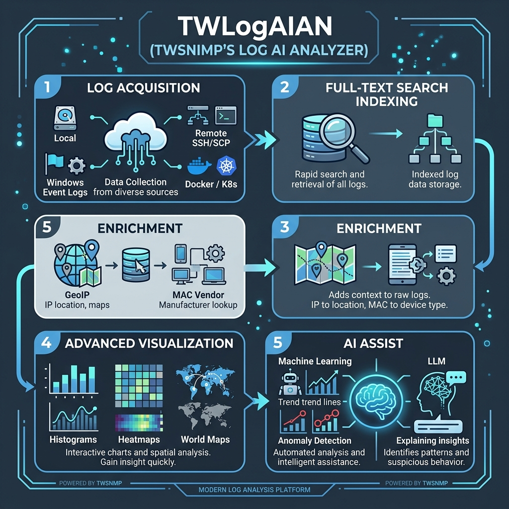

# TWLogAIAN

TWSNMP`s Log AI Analyzer

[日本語のドキュメント (README_ja.md)](README_ja.md)

## Overview

This project extends the syslog analysis features originally developed for TWSNMP FC into a standalone desktop application.

Log analysis is often done more efficiently by bringing the log files to your own computer rather than accessing a remote log server. If you are a Unix command expert, you might use commands to search and format logs. Many people also load logs into a text editor to search them, or use Excel. This tool is designed to assist you with these tasks. It allows you to load log files directly from compressed files, remote servers, or Docker/Kubernetes command outputs, then indexes them using a full-text search engine to make them searchable. The index can also include supplemental information such as geographic locations or hostnames derived from IP addresses extracted from the logs. You can visualize the search results easily using web technologies. When you're done with the analysis, simply delete the log data folder.




The log files to be analyzed can be retrieved via:

- Local files (ZIP, TAR.GZ, BZIP2, XZ, ZSTD, EVTX, text, etc.)
- Local directories
- Local command execution results (Docker, Kubernetes, etc.)
- Remote server transfer via SCP / SFTP / FTP
- Remote SSH command execution results (Docker, Kubernetes, etc.)
- HTTP / Web API log fetching
- Grafana Loki integration
- Elasticsearch integration
- TWSNMP FC integration
- Windows Event Log

Log analysis features:

- Automatic log type determination
- Automatic timestamp retrieval
- Storage engine selection (Bluge, Parquet, Badger, Bbolt)
- Regular expression, simple text filtering, and AI-assisted regex generation
- Pattern-based data extraction (with AI-powered Grok pattern generation)
- Location and hostname estimation from extracted IP addresses
- Vendor name estimation from extracted MAC addresses
- Store logs and extracted data into a full-text search index (Bluge) or high-performance columnar/KV store (Parquet/Badger/Bbolt)
- Search by time range, keywords, regular expressions, numeric range, and geolocation range
- Visualization of log counts and extracted data on graphs/maps:
  - Histogram
  - Cluster
  - Time series
  - World Map
  - Globe
  - Heatmap
  - Email Detailed Analysis Report (v2.1.0)
  - Interval & Access Delay Analysis Reports (v2.1.0)
- Export analysis results to CSV or Excel
- Create chronological notes from selected logs
- AI-assisted anomaly detection with Machine Learning & Deep Learning (Isolation Forest, LOF, AutoEncoder, LSTM, KNN, Mahalanobis distance, Z-Score)
- AI explanation and summarization across report views and search results
- Explain logs and answer questions with embedded local LLM (tensai with GPU acceleration) and external LLMs (Ollama, Gemini, OpenAI, Anthropic)

Technologies used:

- Go Language (Backend)
- Wails v2: Go GUI creation framework
- Svelte 5 / Vite 8: Frontend framework and build tool
- Bluge: Go full-text search engine
- Parquet / Badger / Bbolt: High-performance storage engines
- tensai: Embedded local LLM & neural network inference engine (with GPU acceleration)
- langchaingo: External LLM integration library
- p5.js / p5-svelte: 2D/3D visualizations
- Apache ECharts: Rich charting
- Primer/CSS, Octicons: UI design system
- TensorFlow.js: Frontend AI anomaly detection

The backend provides high-performance, parallel processing in Go, while the JS/CSS/HTML frontend delivers rich and expressive visualizations.

## Document

https://twsnmp.github.io/TWLogAIAN/

## Status

- v1.0.0 (2022/3/2) First release
- v1.1.0 (2022/3/14) External link (TWSNMP FC integration, Windows Event Log)
- v1.2.0 (2022/3/21) Memo function support
- v1.3.0 (2022/4/3) AI assist support
- v1.4.0 (2022/4/11) Improved Grok pattern editing function
- v1.5.0 (2022/4/24) Data extraction during search, improved Grok pattern editing function
- v1.6.0 (2022/10/29) Grok pattern/field editing improvements, automatic log type determination
- v1.7.0 (2023/1/15) English localization support, improved search features
- v1.8.0 (2023/2/5) Grok pattern editing/selection improvements, timestamp processing improvements
- v1.9.0 (2023/2/12) Windows event log processing improvements, log highlighting
- v1.10.0 (2023/6/12) Windows event log improvements, TF-IDF anomaly detection
- v1.11.0 (2025/4/14) LLM/RAG integration
- v2.0.0 (2026/6/20) Upgrade to Svelte 5 / Vite 8, custom GrokEditor, LLM integration (RAG removed)
- v2.1.0 (2026/9/6) Embedded local LLM (tensai/GPU), storage engine options (Parquet/Badger/Bbolt), AI report explanation & summary, deep learning anomaly detection (AutoEncoder/LSTM/KNN), expanded log sources (HTTP/Loki/ES/FTP), email & delay analysis reports

## Build

Wails v2 installation is required for the build.

https://wails.io/docs/gettingstarted/installation/

The build will be done with make.

```
$make
```

The following targets can be specified:
```
all Build all executable files (optional)
mac Building an executable file for mac
windows Build an executable file for windows
windebug Build debug version executable file for Windows
clean Delete the built executable file
dev Starting the debugging environment
```

An executable file for MacOS and Windows will be created in the `build/bin` directory.

To start for debugging
```
$make dev
```

## Copyright

see ./LICENSE

```
Copyright 2022-2026 Masayuki Yamai
```
