# TWLogAIANのマニュアル

AIアシスト付きのすごいログ分析ツール


## ログ分析フローの解説


## TWLogAIANを作っている理由

TWLogAIANは2022年の元日から開発を開始した
**「私のためにAIがアシストしてくれるログ分析ツール」**
です。このツールを開発している一番の目的は私自身が実務で使うことです。開発や保守しているソフトの問題を調査するためのログ分析に利用するのが一番の目的です。このような目的に最適なツールを作っています。

## 一般的なログ分析システムと違う点

- 分析中だけログを保持する
- 分析が終わったら跡形もなく削除できる
- 普通のパソコンで使える
- 自分専用の全文検索のためのインデックスを作成/削除できる

というようなことだと思っています。問題の調査のためにログを提供してもらって調査によって問題が解決したらフォルダーを削除すれば全部消せるという感じです。大規模なログ分析システムだと、それなりの性能のサーバーが必要ですが、自分のパソコンで簡単に分析できるような工夫をしています。


## できること

- ログをどこからでも高速に集めてこれる
- 集めたログを高速にフィルターできる
- ログから簡単かつ高速にデータを抽出できる
- ログと抽出したデータから全文検索エンジンのインデックスを作成できる
- 集計や抽出したデータを簡単に検索してAI分析できる
- 集計や抽出したデータ、AI分析結果を簡単にビジュアル化できる
- 分析結果のリストやグラフを簡単にCSV,Excelファイルに保存できる


# 分析対象のログ

- ローカルファイル
- リモートファイル（SCP経由）
- TWSNMP FCに保存したログ
- Docker/Kubernetsのログ（コマンド/SSH経由）
- Gravwellのログ
- Windowsのイベントログ(リモートも含む)


# TWLogAIANの中身

開発はGO言語で行っています。全文検索エンジンにはBluge

https://blugelabs.com/bluge/

を使っています。


## Windows版のインストール

Microsoft Storeに公開しています。

[Microsoft Store](https://apps.microsoft.com/detail/9p8tqlg999z3)


## MacOS版のインストール

Apple App Storeで公開しています。

https://apps.apple.com/app/twlogaian/id1664596440


## Linux版のインストール

最新のリリースは GitHub Releases から入手できます。

https://github.com/twsnmp/TWLogAIAN/releases

1. Linux (amd64) 版のアーカイブ `TWLogAIAN-linux-amd64.tar.gz` をダウンロードします。
2. ターミナルでアーカイブを展開します。
   ```bash
   tar -zxvf TWLogAIAN-linux-amd64.tar.gz
   ```
3. 展開された実行ファイル `TWLogAIAN` を実行します。
   ```bash
   ./TWLogAIAN
   ```

### 注意事項
TWLogAIAN は GUI の表示に Wails フレームワークを使用しているため、動作には **GTK3** と **WebKit2GTK (4.1)** ライブラリが必要です。起動時にライブラリエラーなどが発生した場合は、以下のコマンドで必要なパッケージをインストールしてください。
- **Ubuntu / Debian 系:**
  ```bash
  sudo apt update
  sudo apt install libgtk-3-0 libwebkit2gtk-4.1-0
  ```
- **Arch Linux 系:**
  ```bash
  sudo pacman -S gtk3 webkit2gtk-4.1
  ```


## インストーラーのダウンロード

最新のリリースは

https://github.com/twsnmp/TWLogAIAN/releases

にもあります。

Windows版のMSI形式のインストーラーファイル `TWLogAIAN.msi`、MacOS版のパッケージファイル `TWLogAIAN_dev.pkg`、または Linux版のアーカイブファイル `TWLogAIAN-linux-amd64.tar.gz` をダウンロードしてください。


## Windows版の起動

Windowsの場合はスタートメニューから起動してください。


## MacOS版の起動

MacOSの場合はランチャーなどからお好きな方法で起動してください。


## Linux版の起動

展開したディレクトリで `TWLogAIAN` を実行するか、デスクトップ環境のランチャーに登録して起動してください。


## ようこそ画面

起動すると「ようこそ画面」が表示されます。

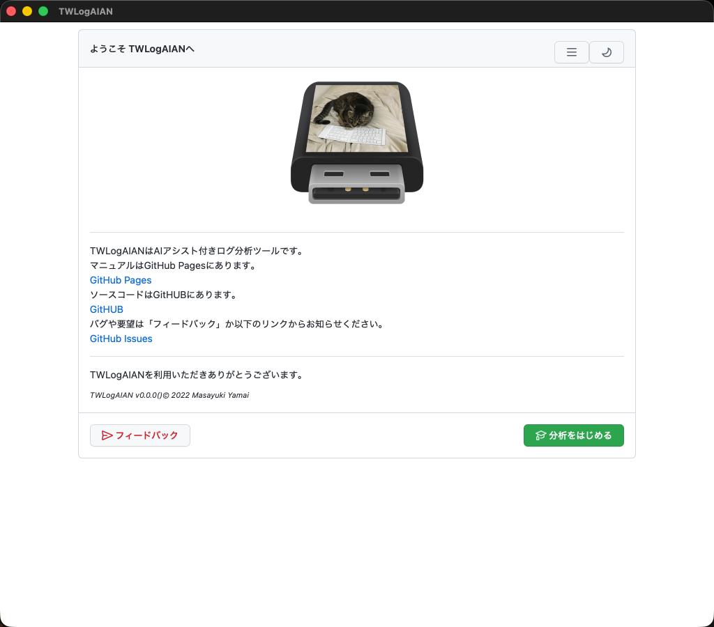

## 画面モードの切り替え

最初はライトモード（白い画面）です。右上の月アイコンをクリックすれば、ダークモードになります。右上の太陽アイコンをクリックすれば、ライトモードに戻ります。切り替えは、この画面でしかできません。ダークモードを使うと玄人ぽく見えます。

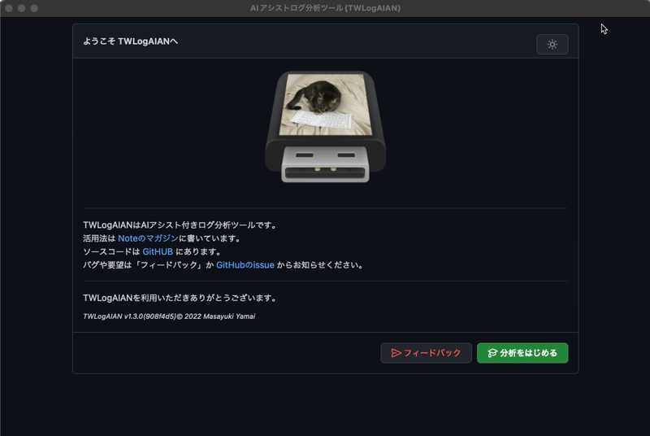

## フィードバック

＜フィードバック＞ボタンをクリックするとフィードバック画面
が表示されます。問題点や要望を入力して＜送信＞してください。
開発者に直接届きます。できるだけ対応します。
**※送信元のIPアドレス以外の情報は送信されません。**

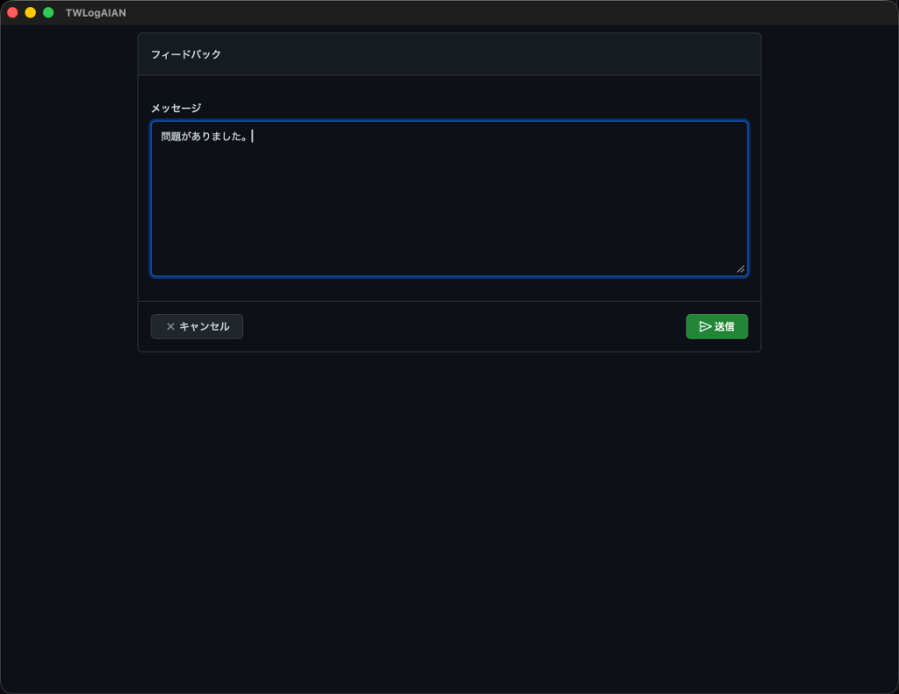


## ログ分析のおおまかな流れ

1. 作業フォルダの選択
1. ログを読み込む場所の設定
1. インデックス作成の設定
1. ログの読み込み
1. ログの検索
1. 分析レポート


## 作業フォルダの選択

ようこそ画面の＜分析をはじめる＞ボタンをクリックすると、作業フォルダの選択画面が表示されます。作業フォルダーには分析のための設定ファイルと全文検索エンジンのインデックスが作成されます。分析が終わったらフォルダーごと削除すれば全部消えます。作業フォルダーを選んで＜選択>ボタンをクリックするとログ分析設定画面を表示します。

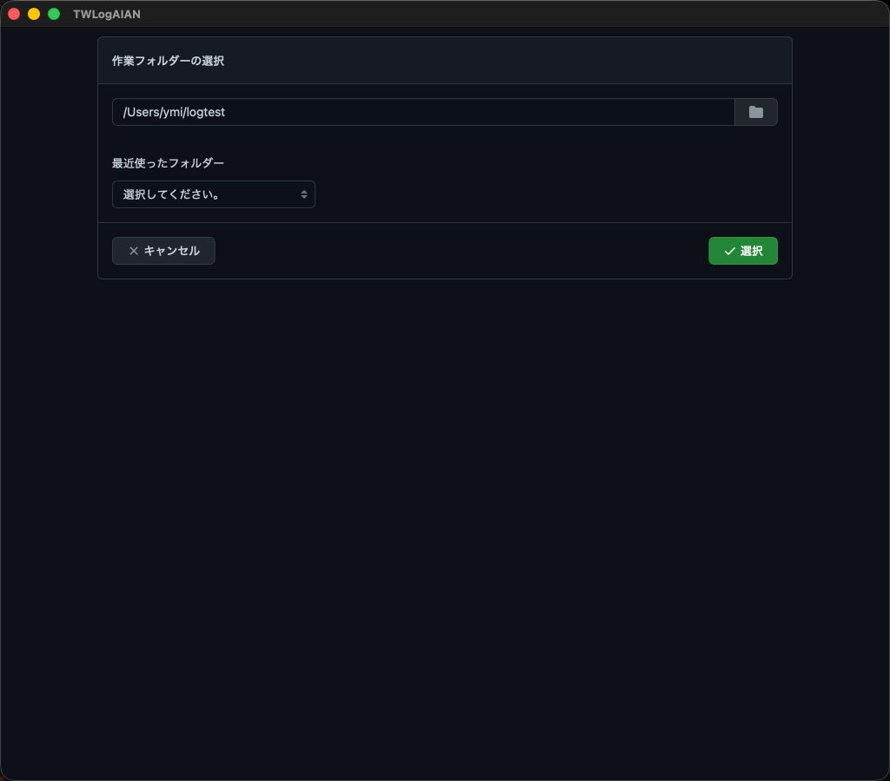


## ログ分析設定画面

作業フォルダーを選択するとログ分析の設定画面が表示されます。ログの種類にカスタム設定を選択して全ての項目を表示した状態です。


### tar.gzの再帰読み込み

tar.gzで圧縮されたファイルの中に更にtar.gzので圧縮されたファイルがあった場合に、その中身も再帰的に読み込みたい場合にチェックします。階層に制限はありません。注意しないと大量のログを読み込むことになります。

### タイムゾーン不明はUTC

ログのタイムスタンプにはタイムゾーンが含まれていないものが多いので、タイムゾーンが不明の場合はローカルタイムとして扱うことにしています。でも、それが嫌な人のためにUTCにする設定をつけておきました。

### フィルター

ログを読み込む時に読み込む行を制限するための設定です。正規表現で指定できます。大量のログの中から分析したいログだけ読み出してインデックスを作成するためのものです。対象のログの量を減らしたほうが読み込みや検索の時間を少なくできます。インデックスのサイズも小さくできます。

アクセスログの例では、

```
POST
```

と設定すればログにPOSTという文字列があるログ(POSTリクエスト)だけ読み込むことができます。


## ログの種類

読み込むログの種類を指定します。情報の抽出方法をTWLogAIANが知っているログの種類には、右のようなものがあります。syslogだけでも古いBSD形式やタイムスタンプにタイムゾーンや秒以下の桁に対応した新しいIETF形式があります。自分で細かく設定したい時は、カスタムを選択します。自動判定を選択すれば、ある程度自動で判定します。


## ホスト名を調べる

ログの中にあるIPアドレスの項目からDNSでホスト名を調べて項目を追加します。
カスタム設定の場合は、”ホスト名解決項目”にホスト名を調べたい項目の変数名を記載します。Apacheのアクセスログなどの組み込みのログタイプの場合は、項目を自動で設定します。


## 位置情報を調べる

ログの中にあるIPアドレスの項目からGeoIPデータベースで位置情報を調べて項目を追加します。カスタム設定の場合は、”IP位置情報項目”に位置情報を調べたい項目の変数名を記載します。Apacheのアクセスログなどの組み込みのログタイプの場合は、項目を自動で設定します。

位置情報のデータベースの入手方法は

https://qiita.com/twsnmp/items/bfeab550b7f9b775f754

で説明してしています。ダウンロードの方法は変わっているかもしれません。
このファイルを設定の下の方にあるIP位置情報データベースに設定してください。


## ベンダー名を調べる

ログの中にあるMACアドレスからベンダー名を調べて項目を追加します。MACアドレスを調べる項目名を"MACアドレス項目"に指定します。MACアドレスとベンダー名の関係はTWLogAIANに組み込んであります。

## タイムスタンプ項目

タイムスタンプとして使う項目の変数名を指定します。空欄の場合は一番左側にあるタイムスタンプぽい文字列を自動でタイムスタンプとして取得します。


## ホスト名解決項目

IPアドレスからホスト名を解決する項目の変数名を指定します。カンマ区切りで複数指定できます。

## IP位置情報項目

IPアドレスから位置情報を取得する項目の変数名を指定します。カンマ区切りで複数指定できます。

## MACアドレス項目

ベンダー名を調べるMACアドレスの項目の変数名を指定します。カンマ区切りで複数指定できます。


## ログ保存先（ストレージエンジン）の選択 (v2.1.0)

TWLogAIAN v2.1.0 から、ログの保存先（ストレージエンジン）を選択できるようになりました。

- **Bluge（デフォルト / 全文検索エンジン）**:
  全文検索インデックスを作成します。単語検索や複合クエリ、フィールド検索を高速に行えます。検索文の「全文検索モード」が利用可能です。
- **Parquet（カラム型ストレージ）**:
  列指向の高性能フォーマットでログを保存します。大容量ログの保存サイズを大幅に削減でき、取り込みも高速です。
- **Badger（高速KVS）**:
  Go言語製の高速なキーバリューストアです。読み書き性能が高く、安定したストレージ性能を発揮します。
- **Bbolt（軽量組み込みDB）**:
  シンプルで信頼性の高い組み込みデータベースです。

> [!NOTE]
> **ストレージエンジンと検索機能の違い**:
> ログ保存先を **Bluge以外（Parquet, Badger, Bbolt）** にした場合、全文検索インデックスを作成しないため **「全文検索モード」は利用できません**。
> 一方で、生のログ文字列に対して直接Goの標準正規表現でマッチングを行うため、**「正規表現モード」が意図通りに正確に動作するようになります**。詳細な検索仕様は [検索文の書き方](./search.html) を参照してください。

## インデックスをメモリ上に作成

ログをメモリ上に保存します（Blugeの場合はメモリ上にインデックスを作成）。プログラムを終了するとデータは消去されます。チェックを外した場合は作業フォルダーにデータが保存されます。

## IP位置情報データベース

GeoIPのデータベースファイルを指定します。


## ログの読み込み場所

TWLogAIANが読み込むことのできるログの場所についての説明です。
右の図の赤枠の部分の説明です。圧縮ファイルの中にあるログファイルも直接読み込むことができます。Windowsのイベントログにも対応しています。


## ログ読み込み元の追加

ログの読み込み元を指定するためには、ログ分析の設定画面の「ログを読み込む場所」のリストにある＜＋＞ボタンをクリックします。ログ読み込み元（ソース）の編集画面が表示されます。

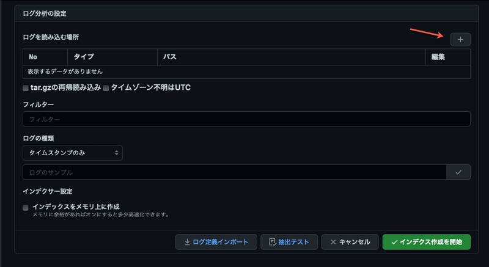

## ログ読み込み元の編集

一度追加した読み込み元はリストの編集ボタン（鉛筆アイコン）をクリック
してください。編集画面を表示します。

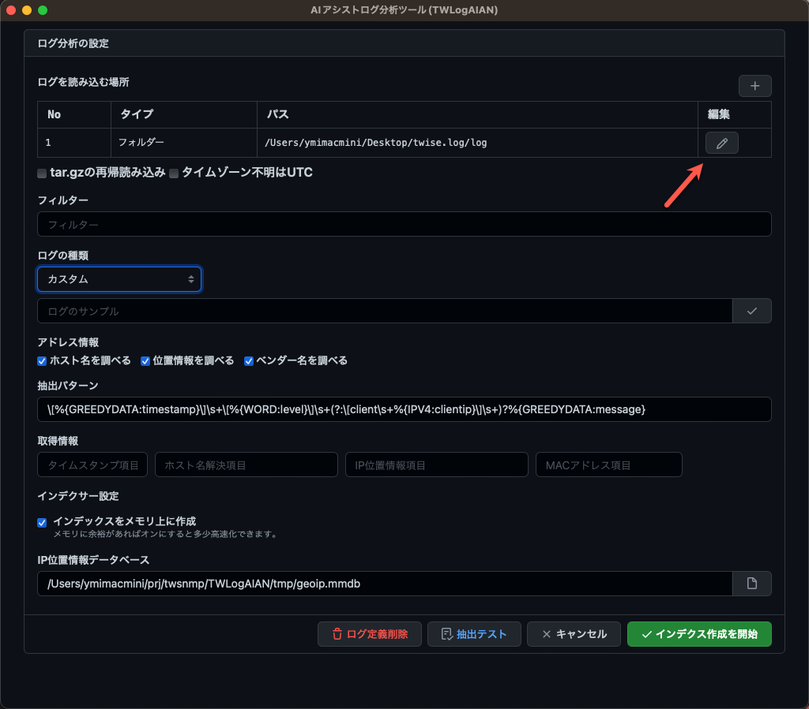

## ログソース編集画面

ログソース（読み込み元）の編集画面は右の図ののような感じです。

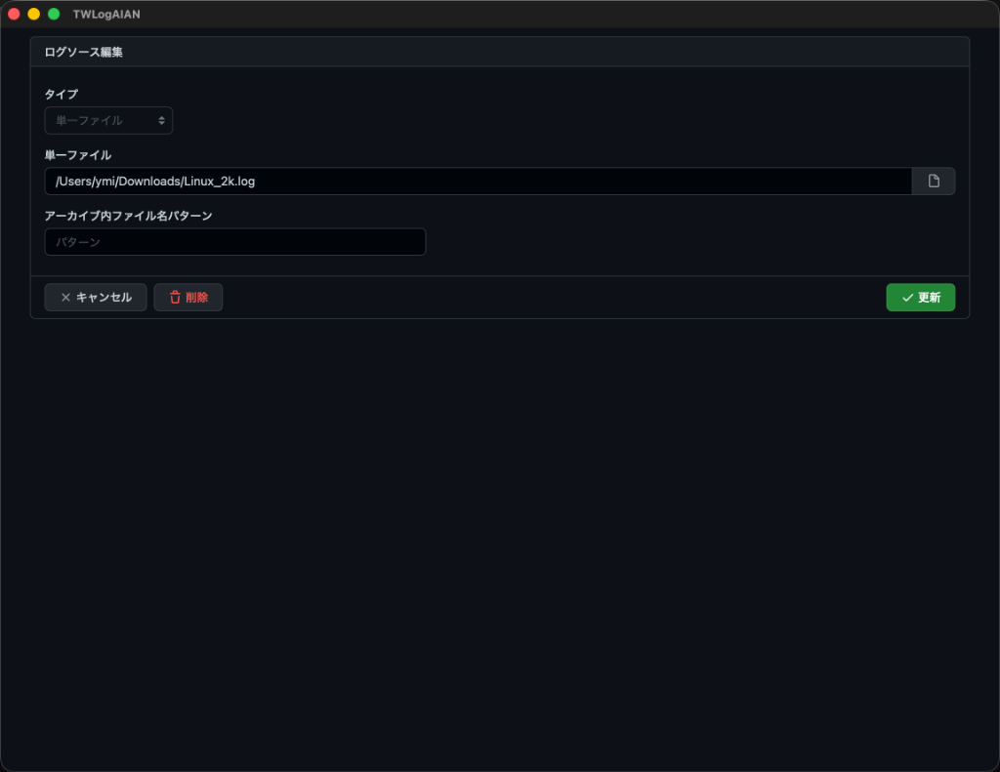

## ログソースの削除

編集画面では編集中のログ読み込み元は削除することができます。
右図の＜削除＞ボタンをクリックしてください。
リストの削除ボタンでも削除できます。

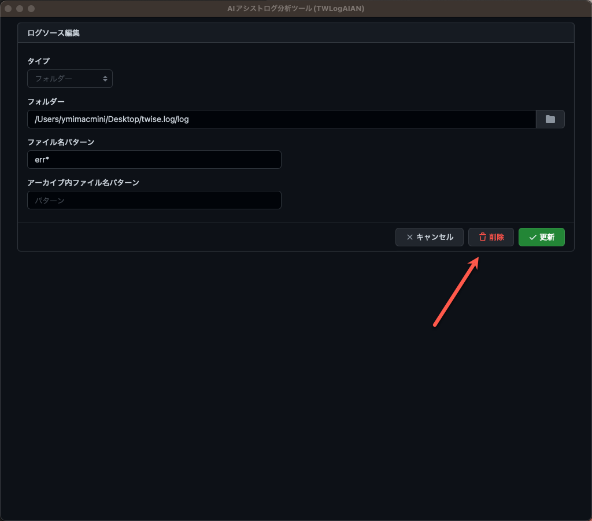


## ログ読み込み元のタイプ

ログ読み込み元のタイプには、図のようなものがあります。Windows版ではWindowsのイベントログを取得するタイプがあります。

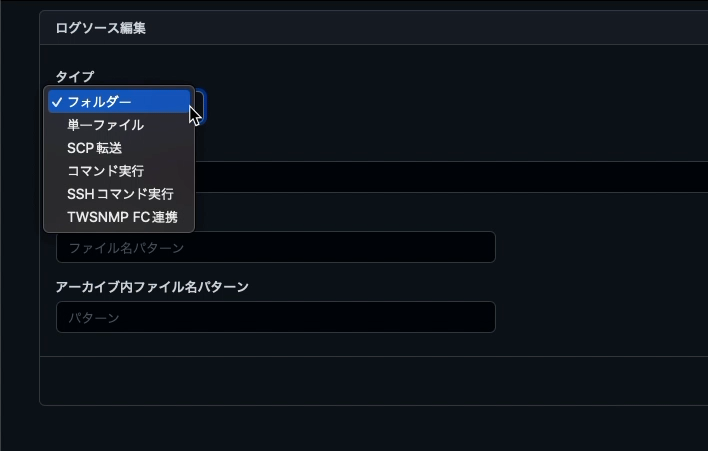


### 単一ファイル

単一のファイルから読み込みます。読み込むログファイルを指定できます。ファイルはファイル名の右にあるボタンをクリックして選択できます。Mac版は、なぜかファイル選択のダイアログが英語になってしまいます。

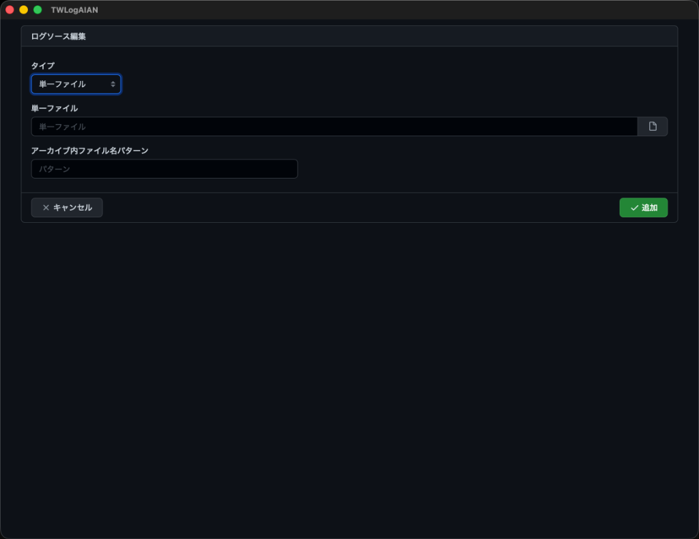


#### アーカイブ内のファイル名パターン

ZIPやtar.gzで圧縮されたファイルも指定できます。圧縮されたファイルの場合には圧縮ファイル内にあるファイルをファイル名で選択するとこができます。アーカイブ内のファイル名パターンで

```
access*
```

のように指定すれば、圧縮ファイル内のaccessから始まるファイルだけ読み込みます。

---

### フォルダー

複数のログファイルが保存されているフォルダーを指定します。選択したフォルダーの中にあるファイルを読み込みます。フォルダーの階層は１階層だけです。子のフォルダーには対応していません。

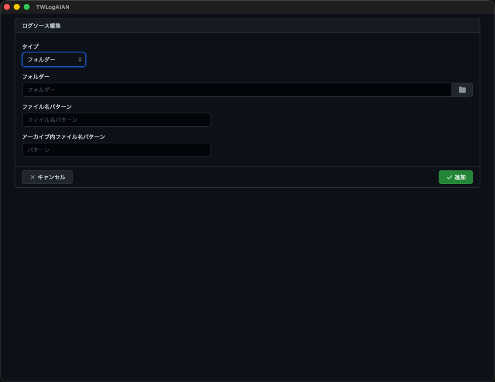

#### ファイル名パターン

フォルダーの中にある特定のファイルだけ対象にしたい場合は、ファイル名パターンを指定します。

```
access*
```

と指定すれば、accessから始まるファイルだけを対象にします。フォルダー内のZIPやtar.gzで圧縮されたファイルも対象です。内部のログファイルを読み込みます。圧縮されたファイルの場合には圧縮ファイル内にあるファイルをファイル名で選択するとこができます。これは単一ファイルの場合と同じです。


### SCP転送

LinuxなどのサーバーにあるログファイルをSCPで転送して直接読み込むこともできます。ファイルを転送してローカルPCに保存してから読み込むよりかなり楽ができます。サーバーのIPアドレス、ホスト名、サーバー上のログファイルのパス、ユーザーIDと秘密鍵のパスワード（あれば）、SSH秘密鍵（キー）ファイル（指定しなければデフォルトの保存場所のファイルを使います。）ファイルがサーバー上のフォルダーにあるだけで後はローカルのフォルダーを指定場合と同じです。ファイル名のパターンや圧縮ファイル名内のファイル名パターンを指定して読み込むログファイルを選択できます。

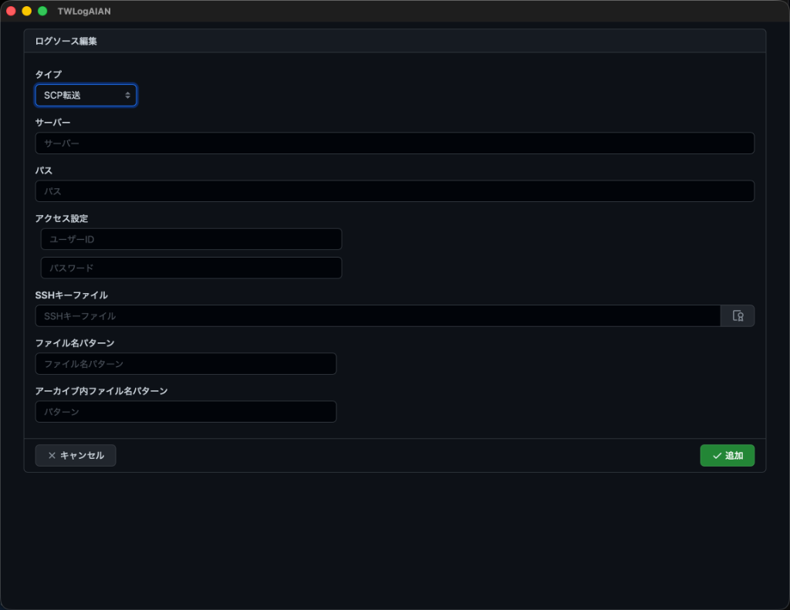


### コマンド実行

コマンドを実行した出力をログとして読み込む機能です。DockerやKubernetsのログをコマンドで取得して分析する時に便利です。実行するコマンドを指定します。

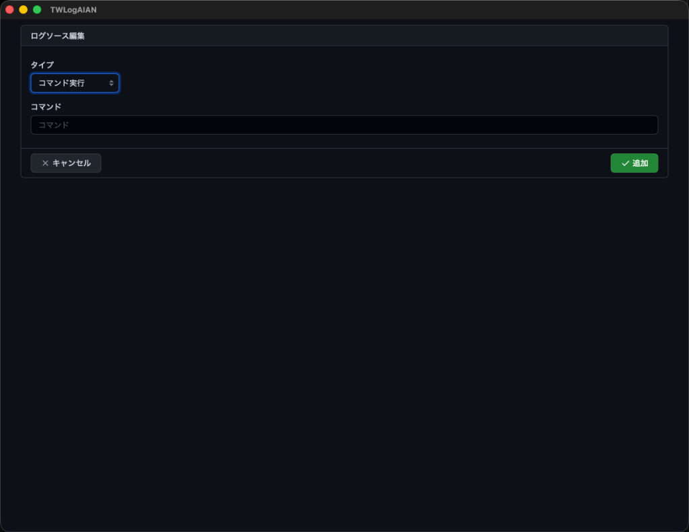

### SSHコマンド実行

コマンド実行と似ていますが、ログを取得するコマンドを実行するのはSSHで接続するサーバー上です。クラウド環境で使うと便利じゃないかと思っています。使ってませんが。実行するコマンド以外にSSHでアクセスするための設定があります。SSHサーバーのアドレス、ユーザー名、パスワード、SSHキーファイルの場所です。

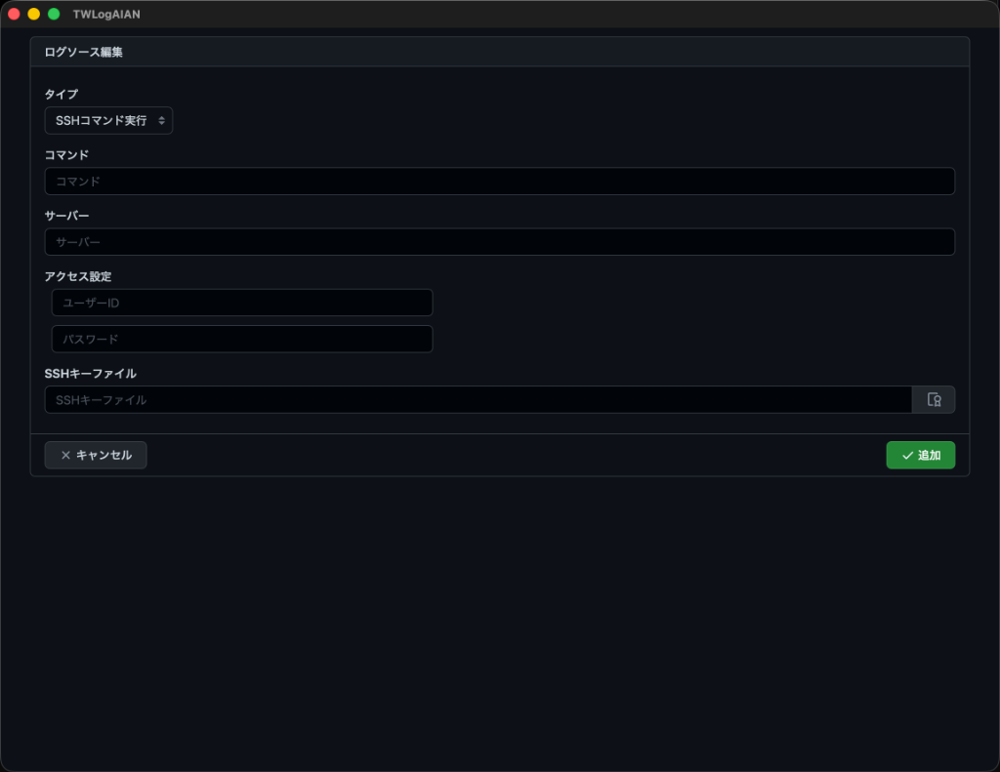

### TWSNMP FC連携

TWNMP FCが集めているsyslogを直接読み込むことができます。サーバーにTWSNMP FCのURLを指定します。アクセス設定にTWSNMP FCにログインするためのユーザーIDとパスワードを指定します。取得するログを検索する条件も指定します。期間とホスト名、タグ、メッセージのフィルターを指定できます。

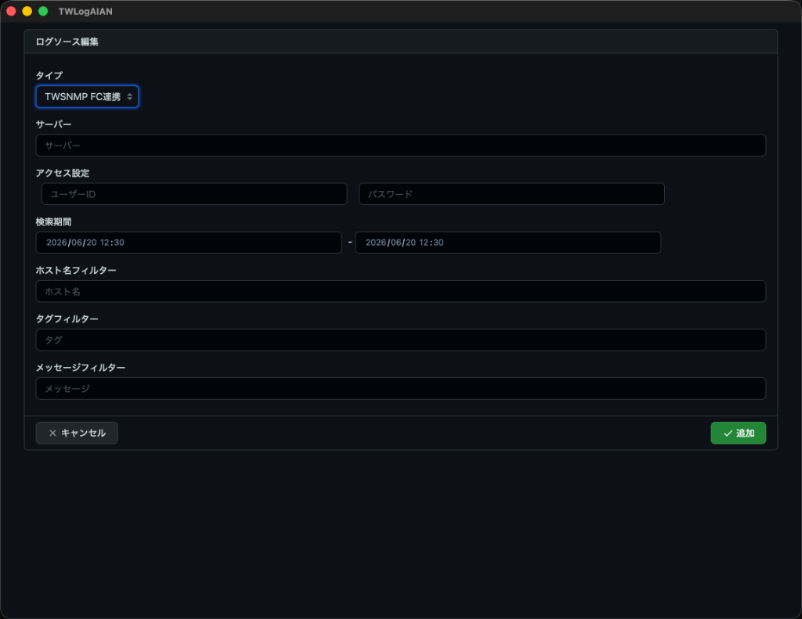


### Windowsイベントログ

Windows環境の場合は、Windowsのイベントログを直接読み込むことができます。wevtutil.exe を実行してログを取得しています。

https://docs.microsoft.com/ja-jp/windows-server/administration/windows-commands/wevtutil


取得中はコマンドプロンプトが表示されます。意図的に表示していますので驚かないでください。TWLogAIANを実行しているWindowsマシンだけでなくリモートサーバーのログも取得できます。サーバーにリモートサーバーを指定します。アクセス設定に認証するためのユーザーID、パスワード、認証の方式を指定します。ローカルのログを取得する場合は指定する必要はありません。取得するログは、期間とチャネルで指定します。セキュリティーチャネルのイベントログを取得するためには、TWLogAIAN を管理者権限で実行する必要があります。

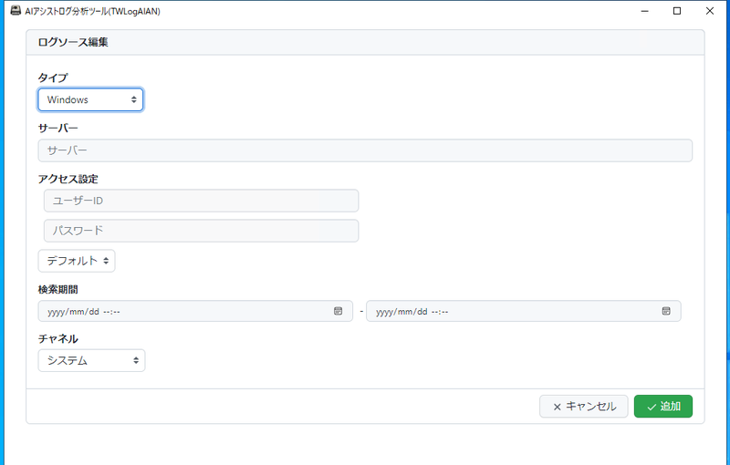

### SFTP / FTP転送 (v2.1.0)

SCPに加えて、SFTPやFTPサーバーからのログファイル転送にも対応しています。サーバーのホスト名、ポート、ユーザー名、パスワード、リモートパスを指定してダウンロード・読み込みを行います。

### HTTP / Web APIからの取得 (v2.1.0)

REST APIなどのWebサーバーに対してHTTP/HTTPSリクエスト（GET / POST）を送信し、レスポンスのJSONやプレーンテキストログを直接取得してインデックス化できます。ヘッダーやクエリパラメータ、認証トークンなどの設定が可能です。

### Grafana Loki連携 (v2.1.0)

Grafana LokiサーバーにLogQLクエリを発行してログを直接インポートできます。LokiのエンドポイントURL、ラベルセレクタ（LogQL）、取得期間、認証情報を指定して取り込みます。

### Elasticsearch連携 (v2.1.0)

Elasticsearchクラスタのインデックスから検索クエリに基づいてログデータを直接インポートできます。クラスタURL、インデックス名、クエリ文字列、時間フィールド等を指定して取り込みます。

## 読み込めるファイルの種類

基本的にはタイムスタンプのあるテキスト形式のログファイルに対応しています。
タイムスタンプの形式は自動で認識できます。gz、bz2、xz、zstdで圧縮されたファイルは自動で解凍して読み込みます。ZIPファイル内のログファイルも読み込めます。tar.gzの場合には、複数階層のフォルダーと多重圧縮に対応してます。tar.gz 内のgzやtar.gzも解凍して読み込めるということです。この再帰的に読み込む場合は、"tar.gzの再帰読み込み"にチェックしてください。Windowsのevtx形式のイベントログにも対応しています。ただし、メモリ上に読み込むために１ファイル１GBまでです。

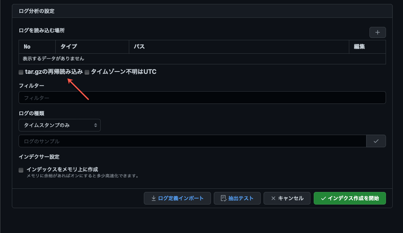

## インデックス作成

TWLogAIANはログファイルを読み込んで全文検索エンジンのインデックス作成を行います。インデックス作成するための流れについて説明します。右の図の赤枠の部分の説明です。

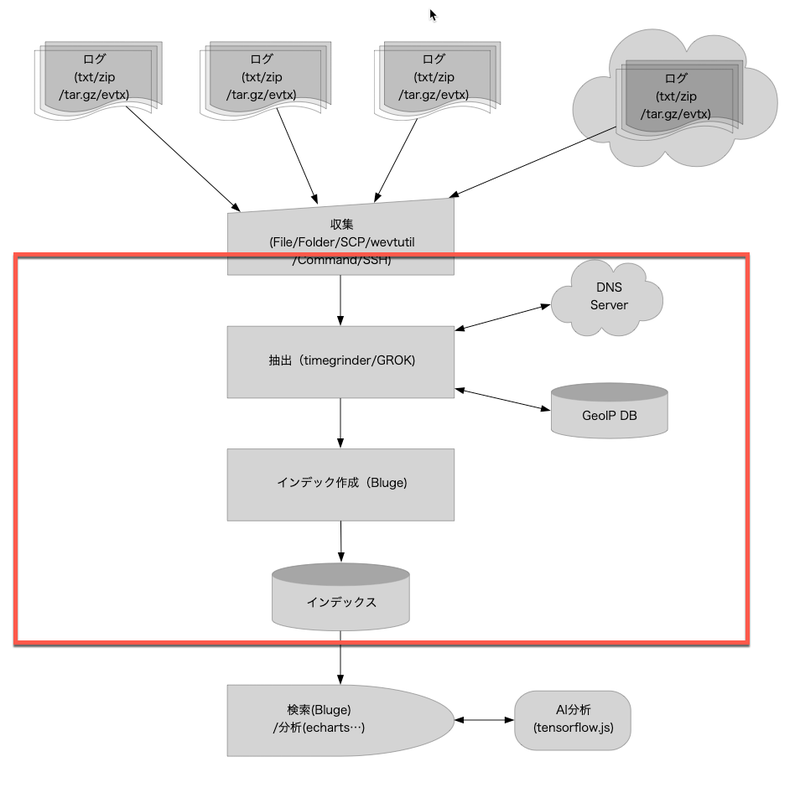


## インデックス作成とは

ログを読み込んだら行単位で意味のなる情報を抽出してインデックスに登録します。例えば、

```
114.119.136.254 - - [03/Apr/2022:00:39:21 +0900] "GET /wiki/index.php?
title=Must_Know_Mlm_Concepts_For_Accomplishment&action=history HTTP/1.1" 404 1417
 "-" "Mozilla/5.0 (Linux; Android 7.0;) AppleWebKit/537.36 (KHTML, like Gecko)
  Mobile Safari/537.36 (compatible; 
  PetalBot;+https://webmaster.petalsearch.com/site/petalbot)"
```

のようなApacheのアクセスログの場合、クライアントのIPアドレス、時刻、リクエスト、パスなどの情報があります。この行をまとめて全文検索エンジンに登録することもできますが、
各項目を抽出してインデックスの項目（フィールド）として登録したほうが検索する時に役に立ちます。検索が早くなるととか集計しやすいとかです。

## ログの種類別の項目取得

この例をApache(Combined)のタイプとして処理すると右の図のような項目を抽出します。この例ではログに書かれている内容から取得したものとクライアントのIPからDNSでホスト名を調べたり、位置情報を調べたりして項目を追加しています。TWLogAIANはログ分析ツールなので、最低タイムスタンプは抽出します。世の中で使われているログの形式に関しては組み込んであります。カスタム設定で自分で抽出項目を選ぶこともできます。

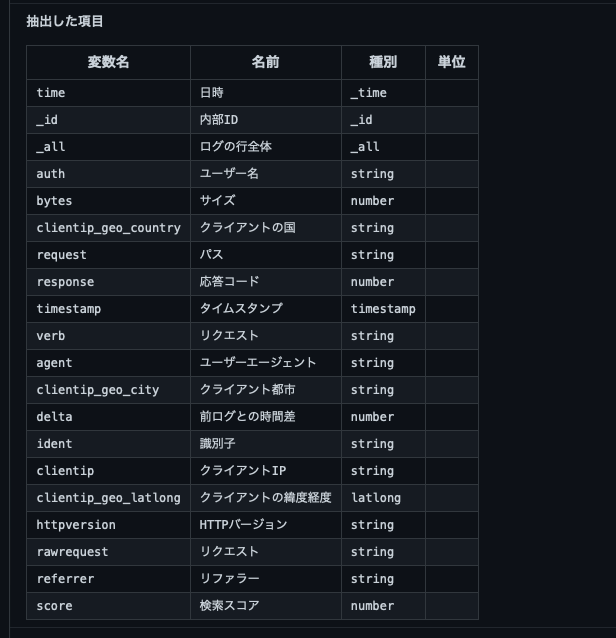


## ログの検索

ログを読み込んで全文検索エンジンのインデックスを作成できたらログを検索することができます。右の図の赤枠の部分です。

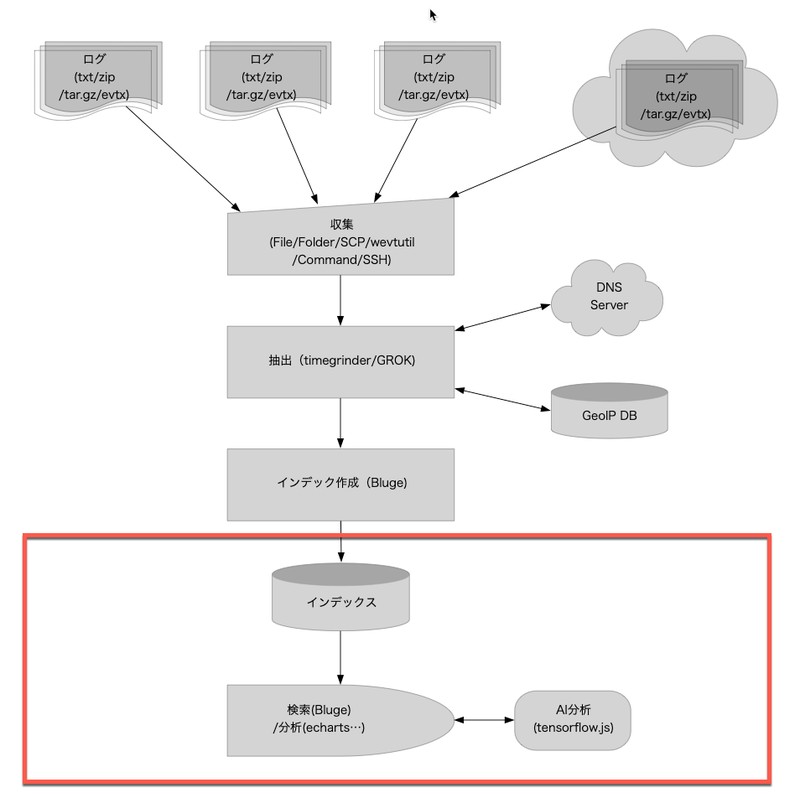

## ログ検索の基本

インデックスの作成が終わった直後は、右の図のような画面になります。インデックスに読み込んだログの件数や処理時間が右上に表示されます。ログ検索の基本は上のほうにある検索文の欄に、検索したいキーワードを入力して検索できます。空欄で検索すると全件表示します。
モードを変更すれば、
https://blevesearch.com/docs/Query-String-Query/
の構文で検索文を入力してできます。

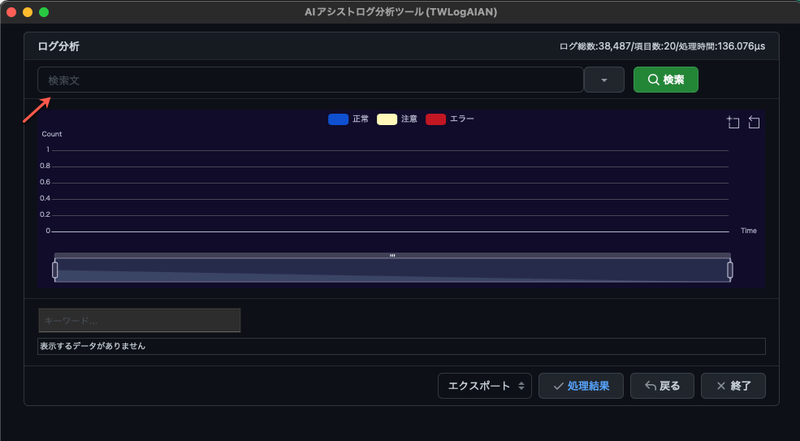


## 検索条件を指定する

検索文の横にある下矢印ボタンをクリックすれば検索条件を指定する画面が表示されます。細かな条件を設定できる画面です。

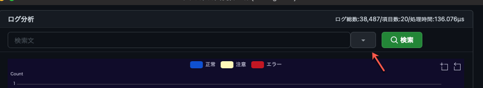

## 検索条件の指定画面

- 検索履歴
- 検索文のモード
- 検索期間
- 最大件数
- 異常ログ検知方法
- 検索時データ抽出

同じ場所にある上矢印ボタンで閉じることができます。

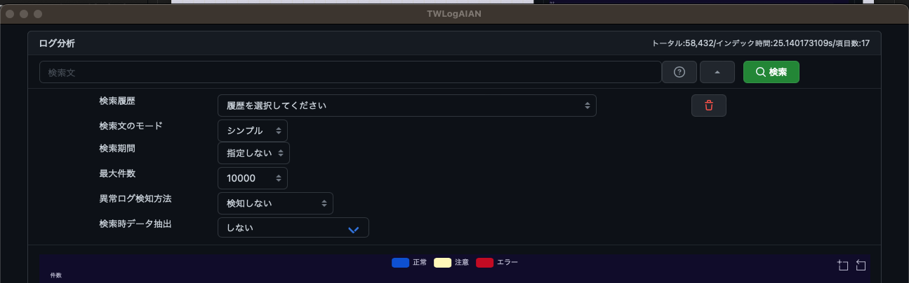

### 検索履歴

以前に実行した検索文のリストです。選択すれば、検索文へ入力します。右端の削除ボタンでクリアできます。

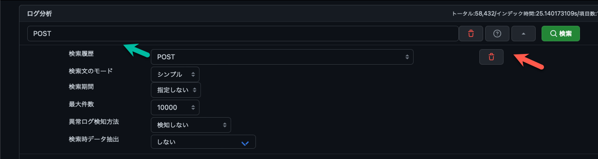

### 検索文のモード

検索文の入力方法を指定します。
- **シンプル**: 単純に検索したいキーワードをスペース区切り（AND）、`!`（NOT）、`*`（前方一致）で入力します。
- **正規表現**: 検索文を正規表現で入力します。ストレージエンジンが **Bluge以外（Parquet/Badger/Bbolt）の場合は完全・高精度に動作します**。
- **AI正規表現 (v2.1.0)**: 探したいログの内容を自然言語で入力すると、LLMが最適な正規表現を考案して検索します。
- **全文検索 (Bluge専用)**: 全文検索クエリ構文による高度な検索を行います。キーワードと数値判定の入力ヘルパーも表示されます。

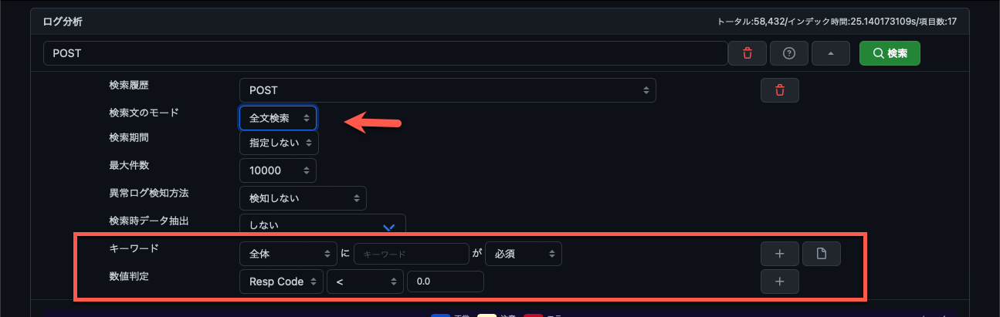


###  検索期間

ログを検索する時間範囲を指定します。２つの指定方法があります。
- 対象指定
タイムスタンプをコピペして対象の時間を指定するモード

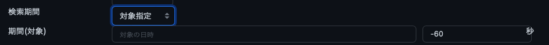

- 範囲指定
時間の範囲を指定するモード


## 異常ログ検知方法 (v2.1.0 強化)

AI（機械学習・ディープラーニング）で検索したログの中から異常ログを検知します。検知するためのアルゴリズムとして以下から選択できます。

- **Isolation Forest**: 孤立森林アルゴリズムによる決定木ベースの高速な外れ値検知
- **Z-Score (v2.1.0)**: 統計的標準化による閾値判定
- **Local Outlier Factor (LOF)**: 局所的な密度に基づく外れ値検知
- **KNN (K-Nearest Neighbors) (v2.1.0)**: 近傍距離に基づく異常度算出
- **マハラノビス距離 (Mahalanobis) (v2.1.0)**: 変数間の相関を考慮した多変量外れ値検知
- **Auto Encoder (tensai) (v2.1.0)**: ニューラルネットワーク自己符号化器による再構成誤差検知
- **LSTM (tensai) (v2.1.0)**: 長短期記憶ネットワークによる時系列パターンの異常検知
- **Sum**: 特徴量の総和による単純比較

検知アルゴリズムを選択した場合に特徴量の計算方法を選択できます。
- 数値データ
- 数値データ＋曜日・時間帯
- 文字列＋数値データ
- 文字列＋数値データ＋曜日・時間帯
- SQLインジェクション攻撃パターン数
- OSコマンドインジェクション攻撃パターン数
- ディレクトリトラバーサル攻撃パターン数
- アクセスログ（Walu）パターン数
- TF-IDF（単語重要度ベクトル）

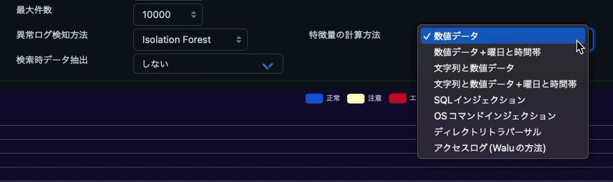


# 検索結果の表示

検索文を入力して検索を実行すると結果が表示されます。


## グラフの時間範囲と連動

グラフの時間範囲を変更するとログのリストも連動して表示するログを変えます。
グラフの右上のズームボタンを押せばグラフをドラックして範囲を指定できます。

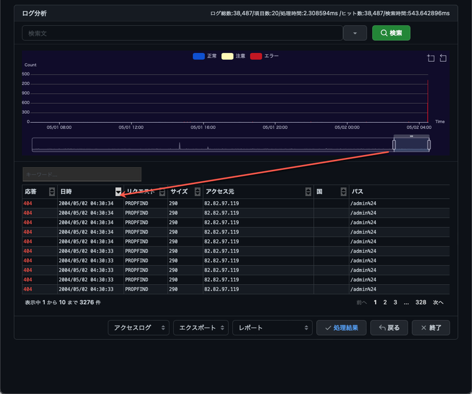

## キーワードでフィルター

キーワードに文字列を入力すれば、ログの中に含まれる文字列でフィルター表示できます。

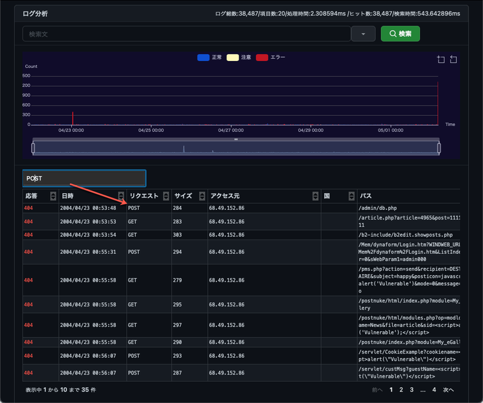

## ログの表示形式

検索結果の下にログの表示形式を選択する項目があります。これを切り替えるとリストの表示形式を変えることができます。

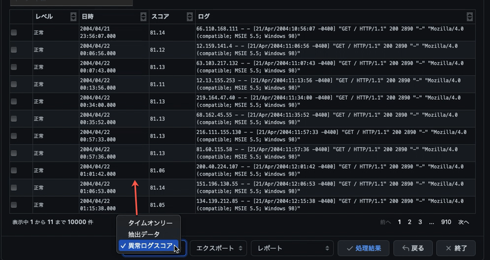

### タイムオンリー

時刻、検索スコア、ログの行だけの表示です。左側のチェックボックスにチェックしてログを選択すると、クリップボードにコピーやメモに保存できます。

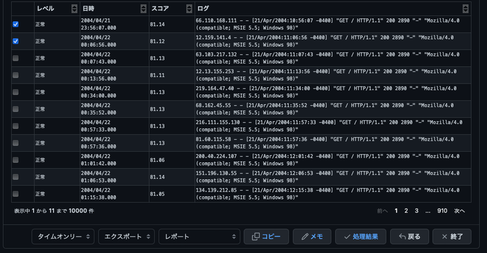

### syslog

syslogに特化した表示です。syslog形式で情報を抽出していないログでは表示できません。

### アクセスログ

アクセスログに特化した表示形式です。アクセス形式で情報を抽出していないログでは表示できません。右の図です。

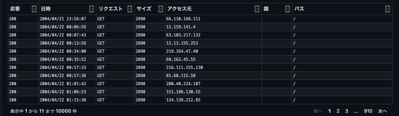

### 抽出データ

ログから抽出したデータをテーブル形式で表示します。項目が多い時には横スクロールできます。

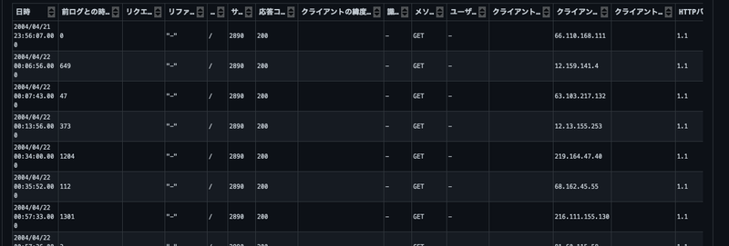

### 異常ログスコア

タイムオンリーと似ていますが、スコアの部分が異常スコアになります。
選択してコピーメモもできます。異常ログの検知をONにした場合だけ表示されます。

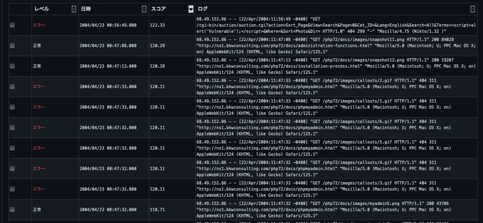


### エクスポート

検索結果の下のほうにエクスポートの選択項目があります。
- CSV:
CSVファイルに表示しているリストを保存します。
- Excel:
Excelファイルに表示しているリストとグラフの画像を保存します。
- AI:
AIにログを説明付きでエクスポートすます。

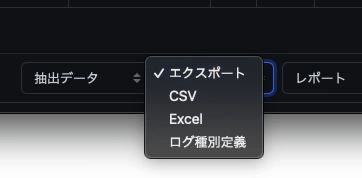


## レポート

ログ分析結果をグラフやリストで表示するレポート機能の説明です。TWLogAIANでログを検索すると画面の下のほうにレポートメニューが表示されます。クリックするとレポートの項目が表示されます。クリックすると対応するレポート画面を表示します。

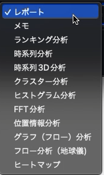


### 処理結果

インデックスの作成やAIの学習状況を後から確認するための画面を表示します。ログの量、抽出した項目、ログの量が多い時間帯が確認できます。

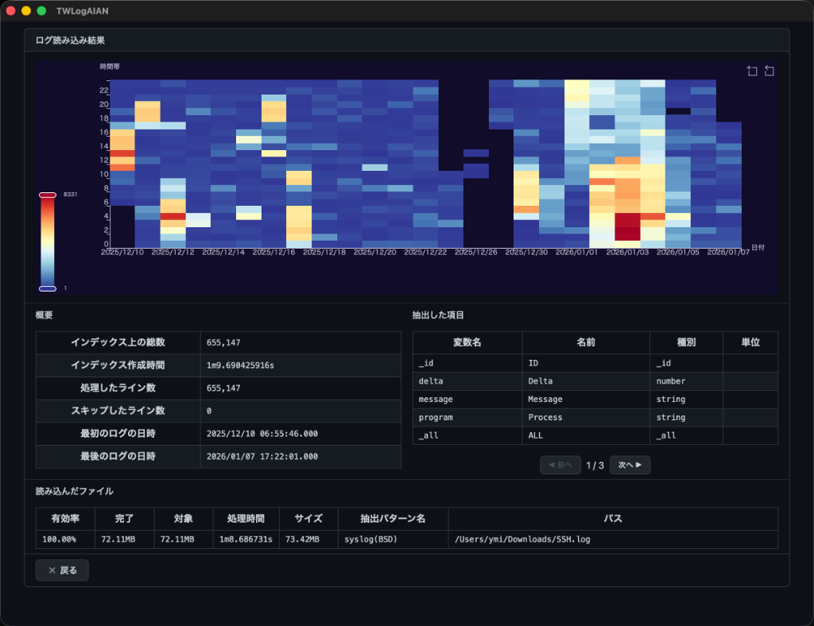


### メモ

ログ検索の画面でメモに追加したログに関するメモを表示するレポートです。
ログのリストの右にある＜メモ＞ボタンで追加できます。

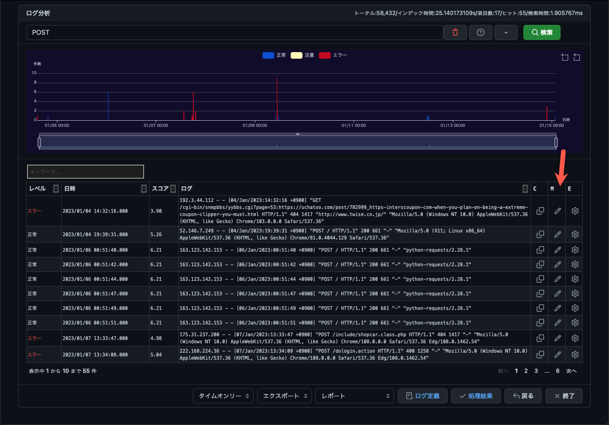


### メモの表示
「レポート」メニューの「メモ」をクリックするとのような画面を表示します。メモに追加したログを時系列に並べて表示します。

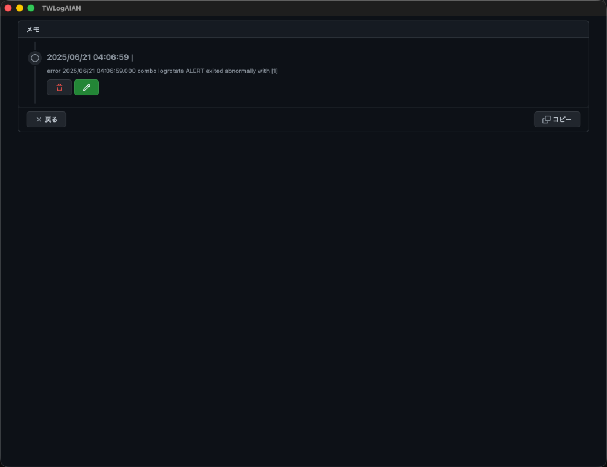


メモには削除するための＜削除＞ボタンと＜編集＞ボタンがあります。

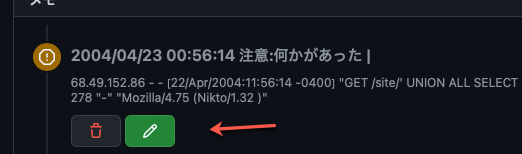

編集画面で、レベルを選択して説明を追加できます。選んだログが何を表しているかメモしておくための機能です。

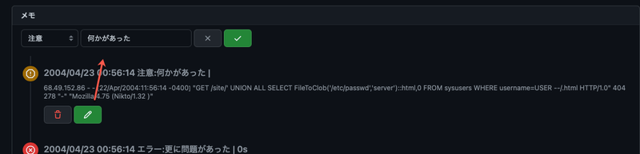

メモが完成したら画面の下にある＜コピー＞ボタンをクリックすれば、メモをテキスト形式でクリップボードにコピーできます。分析結果をメールに貼り付けて報告するのに便利です。

### ランキング分析

ログから抽出した情報を元に集計したランキングを表示します。集計する項目を右上のメニューで選択できます。

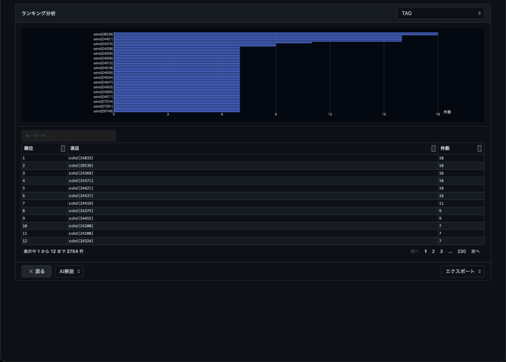


### 時系列分析

ログから抽出した数値データを時系列でグラフ表示します。右上に集計する項目と表示内容を選択するメニューがあります。

- 実データ
抽出した数値データをそのまま表示します。
- 分単位の集計
抽出した数値データを分単位で集計して表示します。平均値、中央値、分散、最大値、最小値を表示できます。
- 時間単位の集計
抽出した数値データを時間単位で集計して表示します。平均値、中央値、分散、最大値、最小値を表示できます。

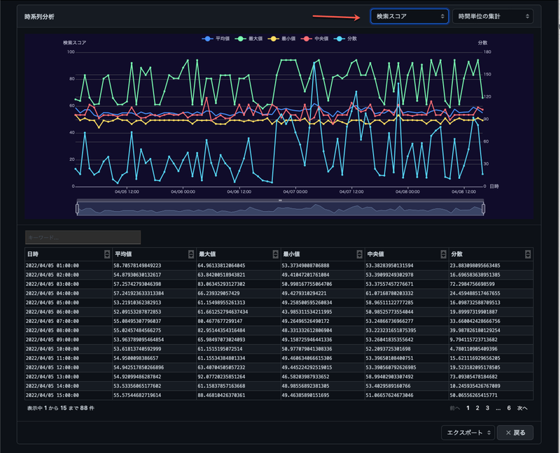


### 回帰分析

数値データを選択した方法で回帰分析した内容を表示します。linearならy=ax+bのような式のaとbを計算して線グラフ表示するものです。右の例ではあまり意味がないです。ディスクやメモリの空き容量を示すデータの場合、減っていく割合が算出できるかもしれません。

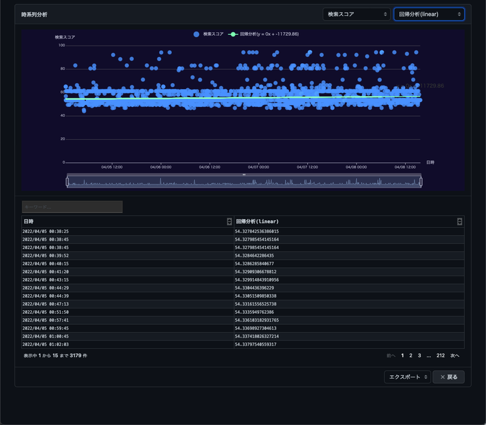


### 時系列３D分析

ログから抽出した数値データを時系列３Dグラフで表示するレポートです。Y軸は時刻固定です。X軸、Z軸、色分けの項目を右上のメニューから選択できます。３Dのグラフはドラッグすれば視点を変えることができます。
***「2dのグラフでは見えないものがある」***
と助手の猫が天から言っています。

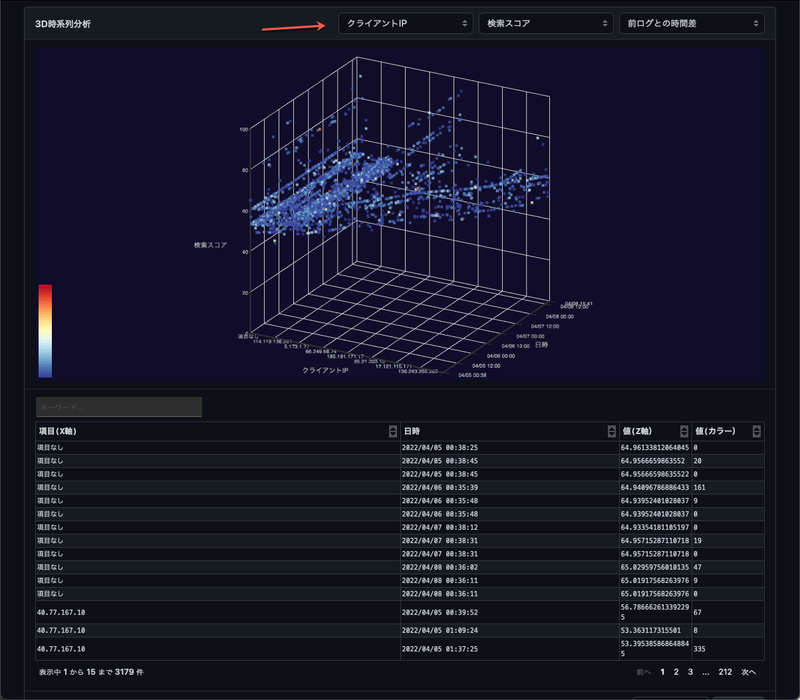


### クラスター分析

ログから抽出した数値データを使ってクラスター分析した結果を表示するレポートです。右上のメニューでクラスター分析のための２つの数値項目と分類するクラスター数を指定します。「クラスター分析で見えるものがある」かもしれません。

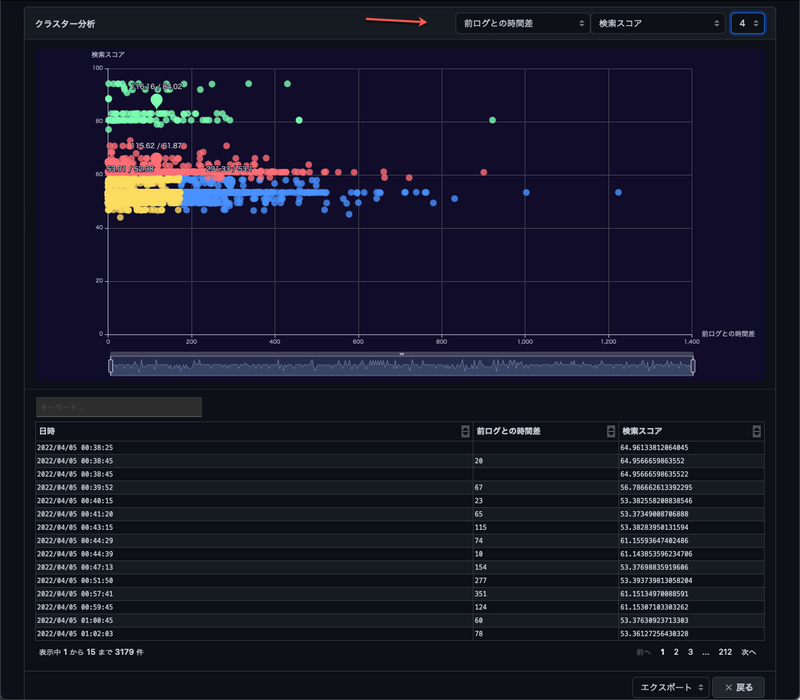

### ヒストグラム分析

ログから抽出した数値データからヒストグラムを表示するレポートです。


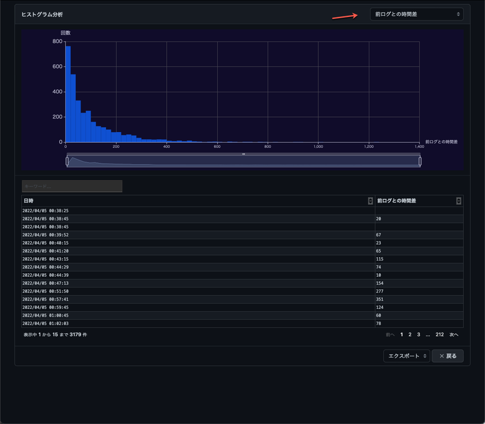

集計する項目を右上のメニューで選択できます。


### FFT分析(3D)

ログから抽出した数値データをFFT分析したレポートです。「FFTで周期的な変化が見えることがある」という感じです。

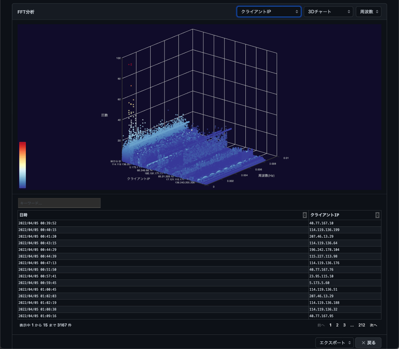

### FFT分析(2D)

右上のメニューで集計する項目、グラフの種類、周波数と周期の切り替えができます。２Dのグラフで特定のIPアドレスからのアクセス周期を示しています。

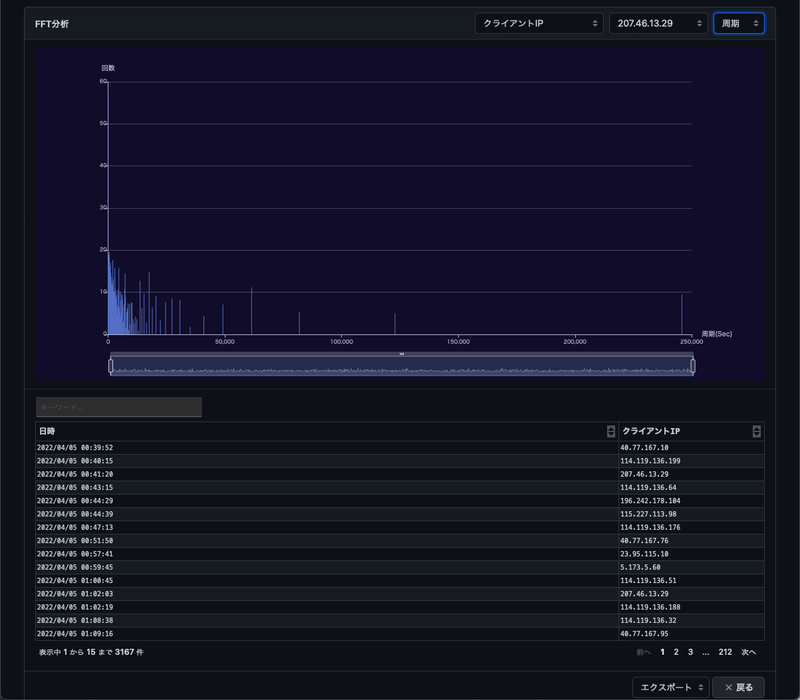


### 位置情報分析

ログの中のIPアドレスから位置情報を検索して表示するレポートです。右上のメニューで位置情報の項目と色分けする数値データの項目を指定します。地図上の点をダブルクリックすればGoogle Mapを表示します。

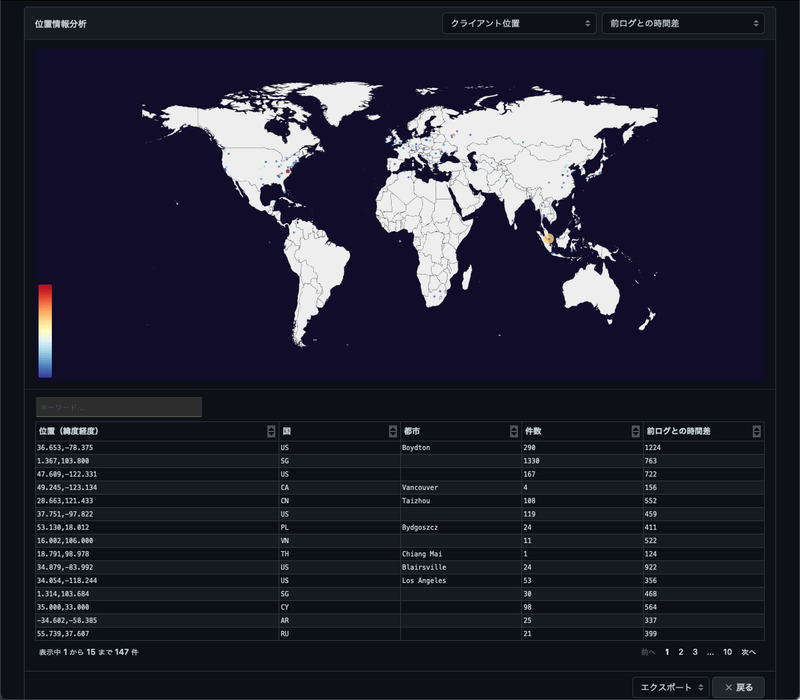


### グラフ（フロー）分析

ログから抽出した２つの項目の関係をグラフ（フロー）で分析するレポートです。ログインしているユーザーとログイン元のIPの関係とかを調べるのに役立ちます。右上のメニューで関係表示する２つの項目と色分けの数値項目、表示の種類を指定できます。


### フロー分析（地球儀）

ログから抽出したIPアドレスから位置情報を検索して通信の様子なども地球儀で表示するレポートです。デモ効果はありますが、「それほど見えるものはない」と思います。


### ヒートマップ

ログの件数などを日単位の時間帯や曜日による時間帯のヒートマップで表示するレポートです。月曜日の９時にログが多いというようなことが見えます。右上のメニューで集計する項目、表示の形式を選択できます。


### メール詳細分析 (v2.1.0)

メールサーバー（Postfix、Sendmail、Exchange等）のログや抽出データを詳細に集計・可視化するレポートです。

- **サマリー統計バッジ**:
  メール総数、SPF Pass率、Fail / SoftFail件数、平均配信遅延（最大遅延）、平均経由ホップ数をヘッダーに即座に集計表示します。
- **SPFレコード検証 (DNS)**:
  チェックを入れると、送信元ドメインのDNS SPFレコードを照会し、送信元IPとの整合性（Pass / Fail / SoftFail / None）を検証してグラフおよびリストに反映します。
- **検証ステータス・グラフ**:
  SPF検証ステータスや配送状況をドーナツチャートで視覚化します。
- **メール一覧テーブル**:
  日時、送信元、宛先、件名、配信遅延、経由数、送信元IP、SPFステータスを一覧表示し、キーワード検索で素早く絞り込めます。


### インターバル分析 (v2.1.0)

同一のホストやIPアドレス、ユーザーなどのログイベントの発生時間間隔（インターバル）を計算・可視化するレポートです。

- **統計バッジ**:
  平均、中央値、最頻周期、標準偏差、最小/最大（Min / Max）をヘッダーに瞬時に集計表示します。
- **グラフ表示切替**:
  推移散布図やヒストグラム表示を切り替えられます。
- **時系列散布図**:
  時間経過に伴うログ発生間隔（秒）をプロットします。下部のスライダーで特定期間をズーム可能で、一定周期のポーリング（例: 300秒ごとの通信ライン）や定期的なC2ビーコン通信、突発的なバーストアクセスなどを視覚的に発見できます。
- **イベント一覧テーブル**:
  日時、間隔（秒）、ログ内容を一覧表示します（キーワード絞り込み・ページネーション対応）。


### アクセス遅延分析 (v2.1.0)

Webアクセスログなどのレスポンス時間、処理遅延（Delta）、およびタイムスタンプ逆転の統計と推移を分析するレポートです。

- **統計バッジ**:
  遅延件数、最大遅延（Max）、平均、中央値をヘッダーに集計表示します。
- **算出モード切替**:
  タイムスタンプ逆転検知などの評価モードを切り替えられます。
- **時系列散布図**:
  日時と遅延時間（秒）をプロットし、下部のスライダーでズーム・スクロールしながら遅延スパイクの発生状況を直感的に把握できます。
- **遅延ランキングテーブル**:
  遅延の大きい順にランク付けされたログ一覧（順位、日時、遅延（秒）、ログ内容）を表示し、キーワードで絞り込めます。


### AI分析レポート (v2.1.0)

読み込んだ大量のログ（または検索対象ログ）をAIが自動分析し、頻出エラーパターンの集計と総合分析サマリーを提示する専用レポートです（各グラフ画面の「AI解説」とは異なり、ログ全体を俯瞰した総合調査レポートです）。

- **ヘッダー統計バッジ**:
  総ログ数、エラー件数、対象期間を即座に把握できます。
- **調査観点プリセット**:
  ワンクリックで分析プロンプトを切り替えられます。
  - **全体サマリー・異常検知**: ログ全体の傾向や異常パターンの総合要約
  - **重大インシデント・不正アクセス調査**: 攻撃兆候や認証失敗、不正通信の調査
  - **性能障害・エラー急増の特定**: システム障害やレスポンス悪化の要因特定
  - **推奨アクション・再発防止策**: 管理者がとるべき対処手順と防止策
- **頻出エラーパターンの自動集計**:
  類似エラーをクラスタリングし、発生回数順に上位エラーパターンを一覧表示します。「該当例を展開」ボタンで実際の生ログ例を確認できます。
- **プライバシー保護 (PIIマスク)**:
  IPアドレスやアカウント情報などの機密情報を自動マスキングした状態でAI分析を実行できます。
- **ストリーミング分析結果 & コピー**:
  リアルタイムで分析テキストがストリーミング生成され、Markdown形式またはプレーンテキストで表示・コピーできます。


### レポートのAI解説機能 (v2.1.0)

各レポート画面（ランキング、時系列、ヒストグラム、インターバル等）の左下にある **「AI解説」メニュー** から、そのグラフや集計データの分析観点を選択してAIに解説を依頼できる機能です。

1. **AI解説の実行**:
   レポート画面の「AI解説」ドロップダウンから観点を選択して実行します。
2. **サイバー猫プログレスモーダル**:
   解析中はかわいいサイバー猫のアニメーションとともに処理進行状況が表示されます。
3. **AI解説結果ダイアログ**:
   集計データに基づいた **概要（Overview）** や **主要な傾向・異常点（Key Findings & Trends）** が整理されて表示されます。言語切替（日本語／英語）、再解説、クリップボードへのコピー、および解説結果のエクスポートに対応しています。

<div align="center">
  
  <p><em>サイバー猫プログレスモーダル（待ち画面）</em></p>
</div>


### エクスポート

この記事で説明した全てのレポートはエクスポートできます。右下にエクスポートのメニューがあります。
- CSV: リストの部分だけをCSVファイルにエクスポートします。
- Excel: グラフとリストをExcelファイルにエクスポートします。


## 設定

### ログ種別定義

ログから情報を抽出するために使ったGrokの設定などを定義ファイルに保存するためのものです。編集して他の分析でも使えるようにするための機能です。

### AI (LLM) 連携設定 (v2.1.0 強化)

ログの解説・要約や問い合わせ（Ask AI）を行うためのLLM連携設定を行います。ログ分析設定画面の右下に配置されています。

- **プロバイダー**:
  - **tensai（内蔵ローカルLLM）**: 外部サーバーやAPIキーを一切必要とせず、お使いのPC内部で完全に動作する組み込みLLMです。ログデータが外部に送信されないため、機密性の高いログでも安心して分析できます。
  - **外部LLM（Ollama, Gemini, OpenAI, Anthropic）**: クラウドアカウントやローカルのOllamaサーバーと連携します。APIキーやモデル名、接続先URLを設定して利用できます。
- **モデルの選択**:
  内蔵ローカルLLMの場合は、ダウンロード済みのGGUFモデル（例: `qwen2.5-coder-0.5b-instruct-q8_0.gguf` など）をドロップダウンから選択できます。
- **ハードウェア加速（GPU）**:
  検出されたGPU環境（Apple MシリーズのMetal、DirectX、Vulkan等のwgpu）がバッジ表示され、高速なハードウェアアクセラレーション推論が行われます。
- **＜モデル管理 / GPU設定＞ボタン**:
  クリックするとモデル管理画面が開き、推奨モデルのワンクリックダウンロードやGPU設定の確認ができます。


#### ローカルLLMモデル & GPU管理画面 (v2.1.0)

「モデル管理 / GPU設定」ボタンをクリックすると表示される管理ダイアログです。

- **GPUアクセラレーション (WebGPU)**:
  現在アクティブなGPU環境（Metal / Vulkan / Direct3D / wgpu）や、`wgpu-native` ライブラリのインストール状態を確認できます。
- **ダウンロード済みモデル一覧**:
  PC内に保存されているGGUFモデルのファイル名、ファイルサイズ、更新日時の一覧と削除操作が行えます。
- **プリセットモデルのワンクリックダウンロード**:
  TWLogAIANで動作確認済みの推奨軽量LLM（Qwen 2.5 0.5B Instruct等）を選択し、ワンクリックでダウンロードできます。
- **カスタムURL / Hugging Faceからのダウンロード**:
  Hugging Faceのリポジトリ名や任意のGGUFモデルURLを直接指定してダウンロードすることも可能です。


### Ask AI（AIに質問する） (v2.1.0 強化)

検索画面やレポート画面でログを選択し、AIアシスタントに詳しい分析や解説を直接問い合わせる機能です。

- **質問プリセット**:
  よく使われる分析観点をワンクリックで選択できます。
  - **ログの解説**: ログ全体の意味や主要要素の解説
  - **原因の分析**: エラーや例外の発生原因の深掘り
  - **対策・対処法**: 推奨されるシステム対応手順
  - **セキュリティリスク**: 不正アクセスや脆弱性の評価
  - **パターン抽出**: 類似ログの抽出ルールの提案
  - **要約**: ログの簡潔なサマリー
- **言語切替**:
  「日本語」または「English」をワンクリックで切り替えられ、指定した言語で回答が生成されます。
- **プライバシー保護 (PIIマスク)**:
  「PIIをマスクして質問」ボタンをクリックすると、IPアドレスやユーザー名、機密情報らしき文字列を自動的にマスキングした上でプロンプトを送信します。
- **ストリーミングMarkdown回答 & コピー**:
  思考中から順次回答がテキスト表示され、整形されたMarkdown（見出し、箇条書き、コードブロック）で快適に閲覧できます。ワンクリックでクリップボードに回答をコピー可能です。


## ログの種類のカスタマイズ

組み込まれているログの種類以外で情報を抽出したい場合にはカスタムタイプを選択します。
抽出パターンをGrokの構文で記述します。Grokのパターンは

https://coralogix.com/blog/logstash-grok-tutorial-with-examples/

がわかりやすいと思いました。
このパターンを理解できれば多くのログ分析ツールで応用できるのでログ分析をするエンジニアのスキルアップにつながると思います。でも、覚える基本は４つだと思っています。

1. %{パターン:変数名}で情報を抽出する設定
2. ログの中で特徴的な文字列はそのまま残す
3. \s+で区切りのスペースの部分を指定
4. .+で可変の文字列を無視する

## Grokパターン編集の起動

TWLogAIANではGrokパターンをできるだけ簡単に作成できる機能を付けています。ログの右にあるE(編集)ボタンをクリックするとGrokパターンを編集する画面が表示されます。


## Grokパターン編集

Grokパターン編集画面には、テストデータに選択したログが表示されます。自動生成ボタンや **「AI生成」ボタン** で抽出パターンを作成できます。編集して＜テスト＞ボタンで抽出のテストができます。
編集してOKになったら名前をつけて保存すればあとで使えます。


## ＜自動パターン生成＞ と ＜AIパターン生成＞ (v2.1.0)

テストデータのログを解析して抽出パターンを作成する機能です。画面下のボタンから実行します。

- **自動パターン生成 (ルールベース)**:
  タイムスタンプ、IPアドレス、メールアドレス、URLや `key=value` 形式のパラメータを正規表現ルールで自動認識してパターン化します。
- **AIパターン生成 (v2.1.0)**:
  LLMがテストログの構文と文脈を読み解き、最適なフィールド名とGrokパターンを自動的に考案します。サイバー猫のプログレスモーダル（「AIでGrokパターンを生成中...」）が表示され、瞬時にパターンが組み立てられます。


## ログ定義

保存した抽出パターンやフィールド定義は、ログ定義で確認できます。
インポートやエクスポートもできます。


## ログ種別定義ファイル

yaml形式なのでテキストエディターで編集できます。

```yaml
extractortypes:
- key: custom_20220307065138
  name: TCP接続数
  grok: '%{TIMESTAMP_ISO8601:timestamp}\s+(?:%{SYSLOGFACILITY} )?%{SYSLOGHOST:logsource}\s+%{NOTSPACE:tag}:\s+.*sce=%{INT:sce}.*'
  timefield: timestamp
  ipfields: ""
  macfields: ""
  view: ""
fieldtypes:
- key: sce
  name: 有効なTCP接続数
  type: number
  unit: "件"
```
